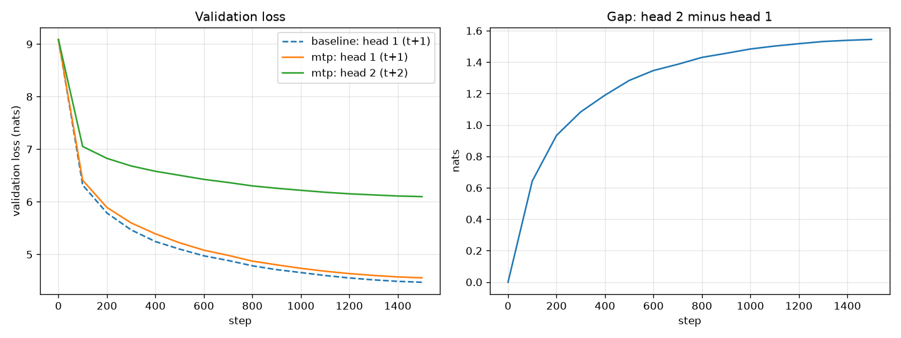

# Session 9: Loss Functions and Output Heads

A small decoder-only language model, trained from scratch, used to build and test the path
from hidden states to the scalar loss: the output head, the next-token shift, padding and
document-boundary masks, perplexity, weight tying, chunked cross-entropy, and a second head
that predicts token t+2.

**Run it:** [`session09.ipynb`](session09.ipynb) runs everything top to bottom, with all outputs saved.

| | |
|---|---|
| Model | 8 layers, D=384, 6 heads (head_dim 64), context 256, RoPE, RMSNorm, pre-norm, SwiGLU (1,024), ~20.5M parameters |
| Data | `HuggingFaceFW/fineweb-edu` (`sample-10BT`), streamed; 20M train + 0.5M validation tokens |
| Tokenizer | Our own byte-level BPE, V = 8,192; `<pad>` = 0, `<eos>` = 1 after every document |
| Training | AdamW (0.9, 0.95), lr 1e-3, 100 warmup steps, cosine to 10%, grad clip 1.0, bf16 autocast |
| Hardware | NVIDIA RTX 5060 Laptop GPU (8 GB), Windows 11, PyTorch 2.11 + CUDA 12.8 |

---

## Part 1: the loss harness

Source: [`experiments/session09.py`](experiments/session09.py) and [`train/loss.py`](train/loss.py).
Full output: [`runs/notebook/03_part1.txt`](runs/notebook/03_part1.txt).

### The seven numbers

| # | Requirement | Result |
|---|---|---|
| 1 | Tensor shapes | `tokens [4,256]` → `hidden [4,256,384]` → `logits [4,256,8192]` → shift → `[1020, 8192]` vs `[1020]` → scalar |
| 2 | Shift check | `targets[t] == inputs[t+1]` for every t; verified as strings (below) |
| 3 | Padding mask | contributing tokens **1,020 → 636**; loss **9.4756 → 6.5788** |
| 4 | Boundary mask | loss **6.4687 → 6.4718** (16 boundaries masked) |
| 5 | Perplexity | untrained **9,101** vs V = **8,192**; after 150 steps **646** |
| 6 | Head parameters | untied **20,453,760** vs tied **17,308,032** |
| 7 | Peak memory (head + loss, fwd + bwd, batch 64) | ordinary **1,548.0 MiB** vs chunked(1024) **132.8 MiB** = **11.7× less**, same loss |

### 1–2. Shapes and the shift

B = 4 sequences of T = 256 tokens give B × (T−1) = 1,020 predictions: the last position has
no next token, and the first token is predicted by nothing. Printed as strings, each input
predicts the token after it:

```
' War'   -> 'rior'
' S'     -> 'aint'
'.'      -> <eos>    fine: learns to end a document
<eos>    -> 'T'      bad: predicts document 2 from document 1 (masked)
```

**Why the shift matters.** Two 150-step runs on identical batches, one with the correct shift
and one where each position predicts its own token:

| Step | Correct shift | No shift (bug) |
|---|---|---|
| 0 | 9.0916 | 9.1184 |
| 50 | 7.1851 | 1.8220 |
| 150 | 6.4472 | **0.1286** |

Both start at ln(V), so the bug is invisible at initialization. The buggy run's loss then
collapses because copying the input is trivial. A beautiful loss curve, and a useless model.

### 3. Padding

Four real documents cut to 256, 192, 128 and 64 tokens and right-padded to 256:

| How the loss is averaged | Positions | Loss |
|---|---|---|
| Everything, pads included | 1,020 | 9.4756 |
| **Pads masked (correct)** | **636** | **6.5788** |
| Pads masked, divided by B×(T−1) | 1,020 | 4.1021 |
| Loss on the pad targets alone | 384 | 14.2734 |

- The wrong denominator scales the loss by the share of real tokens (636/1,020 = 0.624), which changes every batch.
- The loss on pad targets (14.3) is far above ln(V) = 9.0: `<pad>` never appeared as a correct answer, so training pushed its probability down everywhere.
- Right padding doesn't affect the real tokens: their logits with and without the pads after them differ by at most 2.2e-06, because causal attention only looks left.

### 4. Document boundaries

16 windows, each containing one `<eos>`:

| Position type | Count | Mean loss |
|---|---|---|
| `<eos>` → first token of next document (**masked**) | 16 | 5.68 |
| last token → `<eos>` (kept) | 16 | 5.75 |
| everything else | 4,048 | 6.47 |

Masking the boundary pairs **raised** the loss slightly (6.4687 → 6.4718), because those pairs
were easier than average: documents often start the same way (`<eos> → 'The'` had loss 2.39).
The size of the change isn't the point; in a normal batch only ~0.08% of positions are
boundaries. The reason to mask is that the target asks the model to predict document 2 from
document 1, a relationship that doesn't exist.

The loss mask doesn't stop attention from crossing the boundary. Tokens after `<eos>` can
still attend to the previous document; a document-aware attention mask would fix that.

### 5. Perplexity

| | Loss | Perplexity |
|---|---|---|
| Uniform guess, ln(V) | 9.0109 | 8,192 |
| Untrained model | 9.1161 | 9,101 |
| After 150 steps | 6.4711 | 646 |
| After 1,500 steps (Part 2 baseline) | 4.4679 | 87 |

The untrained loss sits slightly above ln(V) because random logits are not perfectly flat:
with logit std σ = 0.39, theory gives about ln(V) + σ²/2 = 9.087. Perplexity is only
comparable between models that share this tokenizer.

### 6. Tied vs. untied head

| Component | Untied | Tied |
|---|---|---|
| Token embedding | 3,145,728 | 3,145,728 |
| Attention (8 layers) | 4,718,592 | 4,718,592 |
| SwiGLU FFN (8 layers) | 9,437,184 | 9,437,184 |
| Norms | 6,528 | 6,528 |
| LM head | 3,145,728 | 0 |
| **Total** | **20,453,760** | **17,308,032** |

Tying saves V × D = 8,192 × 384 = 3,145,728 parameters (15.4%). At the course's V5 size the
same matrix is 131,072 × 4,096 = 536,870,912 parameters.

### 7. Ordinary vs. chunked cross-entropy

Our own `chunked_cross_entropy` processes the positions in chunks. Each chunk's logits are
discarded after its loss is computed and recomputed during backward (`torch.utils.checkpoint`),
so the full `[N, V]` tensor never exists. Chunk losses are summed and divided once by the total
number of valid tokens.

Measured on N = 16,320 positions (batch 64 × 255); the full logits are 510 MiB in fp32:

| Method | Logit rows held | Loss | Peak MiB | vs. ordinary | Median ms |
|---|---|---|---|---|---|
| Ordinary | 16,320 | 6.4711 | 1,548.0 | 1.0× | 70.0 |
| Chunked 4096 | 4,096 | 6.4711 | 423.9 | 3.7× less | 58.9 |
| Chunked 1024 | 1,024 | 6.4711 | 132.8 | 11.7× less | 72.2 |
| Chunked 256 | 256 | 6.4711 | 60.2 | 25.7× less | 103.6 |

- **The loss is identical** (difference exactly 0). Chunking changes what is in memory at once, not the objective.
- **Memory falls with chunk size, down to a floor.** The gradients of h and W (~38 MiB) exist at any chunk size, so chunk 256 saves 25.7× rather than the ~64× that row counts alone suggest.
- **Time:** chunks of 1,024 or more cost about the same as ordinary (the ordering changed between runs); only very small chunks are clearly slower. Recomputing logits adds work, but the ordinary path moves several full `[N, V]` tensors through GPU memory.
- **Gradients match.** Chunk 1024 vs. ordinary differ by 7.2e-3 (relative) in bf16 but only **6.5e-6 in fp32**, so the bf16 difference is rounding: each chunk's share of the head gradient is rounded before the shares are added.

---

## Part 2: a second head predicting t+2

Source: [`experiments/session09_part2.py`](experiments/session09_part2.py), [`model/mtp.py`](model/mtp.py).
Log: [`runs/session09_part2/log.csv`](runs/session09_part2/log.csv).

Both runs start from identical weights and see identical batches: 1,500 steps × 32 × 256 =
12.3M tokens (0.61 passes over the training data). The second head is a separate [V, D]
linear layer on the same final hidden state (+3,145,728 parameters). Its targets are shifted
by 2, and a target is masked if either of the two preceding tokens is `<eos>`.



### Validation loss (boundaries masked)

| Step | Baseline L1 | MTP L1 | MTP L2 | L1 + L2 | L2 − L1 |
|---|---|---|---|---|---|
| 0 | 9.0889 | 9.0889 | 9.0880 | 18.1768 | −0.001 |
| 100 | 6.3266 | 6.4089 | 7.0529 | 13.4618 | 0.644 |
| 500 | 5.1060 | 5.2199 | 6.4991 | 11.7190 | 1.279 |
| 1000 | 4.6577 | 4.7343 | 6.2158 | 10.9501 | 1.482 |
| **1500** | **4.4679** | **4.5516** | **6.0950** | **10.6466** | **1.543** |

| At step 1,500 | Loss | Perplexity | Top-1 accuracy |
|---|---|---|---|
| Baseline head 1 (t+1) | 4.468 | 87 | 24.4% |
| MTP head 1 (t+1) | 4.552 | 95 | 23.4% |
| MTP head 2 (t+2) | 6.095 | 444 | 11.2% |

### What happened

- **Head 2 learns more slowly.** From the same start (about ln V = 9.09), head 1 fell by 4.54 nats and head 2 by only 2.99.
- **The gap widens quickly, then levels off:** 0.64 at step 100, 1.43 at step 800, 1.54 at the end. Head 1 benefits from easy local patterns such as finishing a word (`' S' → 'aint'`). Head 2 can't use them because it never sees the token in between, so it has to spread its probability over every way the text could continue.
- **The extra head cost head 1 some quality.** Head 1 in the MTP model was worse than the baseline at every evaluation from step 100 on, by 0.08–0.14 nats. The sign never changed, so it is probably real, though it comes from a single seed. Both heads share one small trunk, and with equal weights the t+2 objective pulls on it as hard as the main one. Published MTP results report benefits growing with model size; at 20M parameters we see a cost.
- **Head 2 is right 11.2% of the time** against the real text. That is not the speculative-decoding acceptance rate: a draft is accepted when it matches the main model's own prediction, so acceptance would likely be higher.
- **No overfitting:** training and validation losses stay close throughout (0.61 passes over the data).

---

## Reproduce

Windows 11 with an NVIDIA GPU, from the `mini_llm` folder, using [uv](https://docs.astral.sh/uv/):

```powershell
uv sync                          # Python 3.12, PyTorch with CUDA 12.8 (needed for RTX 50-series), dependencies
uv add --dev ipykernel jupyter   # notebook support
```

Then open `session09.ipynb`, select `.venv` as the kernel, and **Run All** (about 12–15 minutes).
Or from the terminal:

```powershell
uv run jupyter nbconvert --to notebook --execute --inplace --ExecutePreprocessor.timeout=-1 session09.ipynb
```

The scripts also run on their own:

```powershell
uv run python check_env.py
uv run python -m data.prepare_data
uv run python -m experiments.session09
uv run python -m experiments.session09_part2
```

Numbers can differ by about 0.01–0.02 between runs because some GPU kernels are not
bit-for-bit deterministic.

## Project layout

```
mini_llm/
├── session09.ipynb          # runs the whole assignment, outputs saved
├── config.py                # DataConfig, ModelConfig
├── check_env.py             # GPU / CUDA / PyTorch check
├── stage1_check.py          # one real batch -> logits, shapes printed
├── data/
│   ├── prepare_data.py      # stream FineWeb-Edu, train tokenizer, write .bin files
│   └── dataset.py           # memmap loader, get_batch -> tokens [B, T]
├── model/
│   ├── layers.py            # RMSNorm, SwiGLU
│   ├── attention.py         # causal multi-head attention + RoPE
│   ├── model.py             # MiniLLM
│   └── mtp.py               # MiniLLM + extra heads (t+2, ...)
├── train/
│   └── loss.py              # shift, masks, lm_loss, chunked cross-entropy, MTP losses
├── experiments/
│   ├── session09.py         # Part 1
│   └── session09_part2.py   # Part 2
└── runs/                    # logs and plots (data/prepared/ and checkpoints/ are not committed)
```

## Session 10 ReadMe file
Session 10 (training loop): see README_S10.md

## Session 11 ReadMe file
Session 11 (Optimizers): see README_S11.md