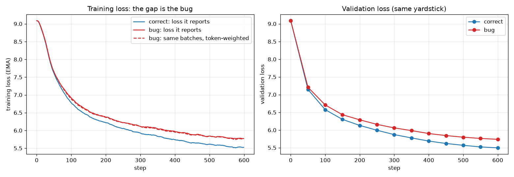
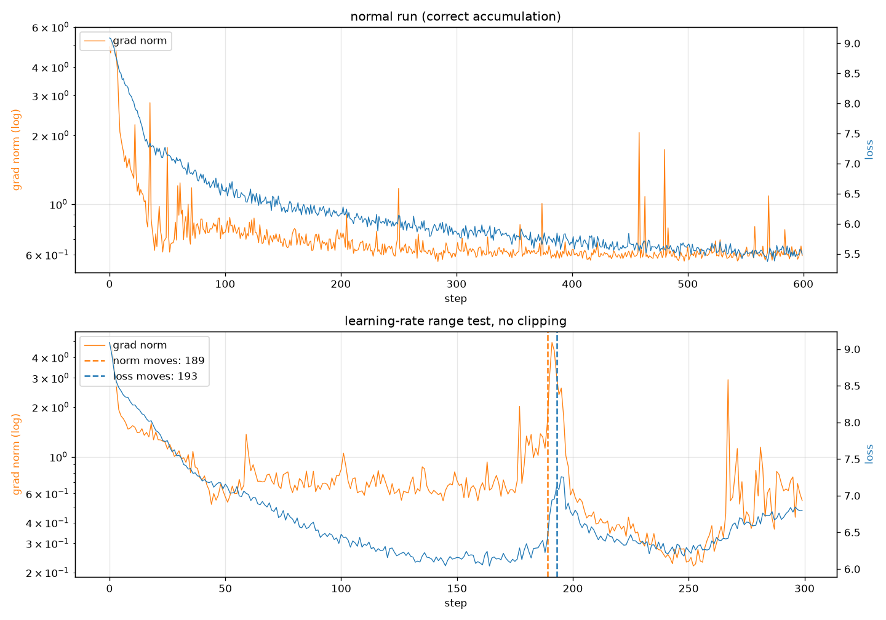

# Session 10: The Training Loop

The same small decoder-only model as Session 9, now with a real training loop that is made
to tell the truth about itself: every tensor shape in a step, one gradient checked by hand,
gradient accumulation broken on purpose, the grad norm logged at every step, an honest MFU,
and the number 0.1 written out bit by bit.

**Run it:** [session10.ipynb](session10.ipynb) runs everything top to bottom, with all outputs saved.
The Session 9 write-up is in [README.md](README.md).

| | |
|---|---|
| Model | 8 layers, D=384, 6 heads (head_dim 64), context 256, RoPE, RMSNorm, pre-norm, SwiGLU (1,024), 20,453,760 parameters, dropout 0 |
| Data | Same as Session 9: FineWeb-Edu (sample-10BT), 20M train + 0.5M validation tokens, own BPE tokenizer, V = 8,192 |
| Training step | AdamW (0.9, 0.95), weight decay 0.1, lr 1e-3, 100 warmup steps, cosine to 10%, grad clip 1.0, bf16 autocast |
| Batch | micro-batch 8 × 4 accumulation steps = 32 sequences per optimiser step |
| Hardware | NVIDIA RTX 5060 Laptop GPU (8 GB, 26 SMs), Windows 11, PyTorch 2.11 + CUDA 12.8 |

### The six tasks at a glance

| # | Task | Result |
|---|---|---|
| 1 | Tensor shapes | 25 tensors from `tokens [8,256]` to the scalar loss, plus gradients, AdamW state and the 16 bytes held per weight |
| 2 | Gradient by hand | nudge vs `backward()` agree to **4.8e-9** (fp64); fp32 gets 1e-2 at best; bf16 can't do it at all |
| 3 | Accumulation bug | gradient **58% wrong** (cosine 0.83); after 600 steps validation loss **5.737 vs 5.498** (+0.24 nats) |
| 4 | Grad norm first | in an lr stress test the norm left its band at step **189**, the loss turned up at step **193** |
| 5 | MFU | **36.6%** at micro-batch 32; **25.6%** for the accumulation loop; as low as 8.7% for the same code on a throttled GPU |
| 6 | 0.1 in bits | fp32 `0 01111011 10011001100110011001101`, bf16 `0 01111011 1001101`, fp8 E4M3 `0 0011 101` |

Full outputs: [runs/notebook/10_checks.txt](runs/notebook/10_checks.txt) (Tasks 1, 2, 6),
[runs/notebook/11_train.txt](runs/notebook/11_train.txt) (Tasks 3, 4),
[runs/notebook/12_mfu.txt](runs/notebook/12_mfu.txt) (Task 5).

---

### Code
- [train/loop.py](train/loop.py): the reusable step for this and later sessions. For each micro-batch it runs forward, loss and backward, letting gradients pile up. It then clips (returning the norm *before* clipping), updates and wipes. It logs every step and has one switch for how micro-batch losses are combined: `"token"` (correct) or `"mean_of_means"` (the pre-2024 bug).
- [experiments/session10.py](experiments/session10.py): one section per task.
- [config.py](config.py): adds `TrainConfig`. `DataConfig` and `ModelConfig` are unchanged.

---

### Task 1: every tensor in one optimiser step

One step = 4 micro-batches × 8 sequences × 256 tokens. Shapes for micro-batch 1, block 1:

| Tensor | Shape | dtype | Meaning |
|---|---|---|---|
| tokens | [8, 256] | int64 | B sequences × T token ids |
| targets (shifted, masked) | [8, 255] | int64 | next token per position; −100 where masked |
| rope cos / sin | [256, 64] | float32 | one rotation angle per position, per pair of dimensions |
| tok_emb(tokens) | [8, 256, 384] | float32 | one D-vector per token |
| attn_norm | [8, 256, 384] | float32 | RMSNorm rescales each token vector, shape unchanged |
| q_proj / k_proj / v_proj | [8, 256, 384] | bfloat16 | queries, keys, values before splitting into heads |
| q, k (heads split, RoPE) / v | [8, 6, 256, 64] | bfloat16 | B × H × T × head_dim: 6 heads of 64 |
| attention output | [8, 6, 256, 64] | bfloat16 | one mixed value per token per head |
| o_proj | [8, 256, 384] | bfloat16 | heads merged back, added to the residual stream |
| ffn gate(x), up(x) | [8, 256, 1024] | bfloat16 | widened: "how much" and "what" |
| ffn down(...) | [8, 256, 384] | bfloat16 | back to D |
| block output (×8) | [8, 256, 384] | float32 | residual stream: blocks refine, never resize |
| final_norm (hidden h) | [8, 256, 384] | float32 | what the head reads |
| logits | [8, 256, 8192] | bfloat16 | a score for every vocabulary token |
| flat logits / flat targets | [2040, 8192] / [2040] | | B×(T−1) classifications |
| loss | scalar | float32 | summed over 2,039 real targets, then divided by all 8,157 in the step |

**After `backward()` on all four micro-batches**, each of the 75 parameter tensors has a `.grad`
of exactly its own shape, in float32 (for example `lm_head.weight` [8192, 384] → grad [8192, 384]).
The grad norm, 4.97 at initialisation, is **one** number for all 20,453,760 gradients.
**After `opt.step()`**, AdamW holds two more tensors per weight, `exp_avg` and `exp_avg_sq`,
also full-shaped and fp32.

- **The dtypes show the precision split.** Matrix multiplies run in bf16, while the residual stream, norms, gradients and optimiser state stay in fp32.
- **16 bytes per weight, measured:** weights 4 + gradients 4 + AdamW m and v 8 = 16 bytes → 312 MiB for 20.45M weights, before any activations. This is the Section 13 table on our own model.

### Task 2: one gradient checked by hand

`dropout = 0`, so two identical forward passes give exactly the same loss (difference 0.0).
That makes a nudge measure only the weight. The check runs in fp64.

Weight `blocks.0.attn.q_proj.weight[58, 314]`, where `backward()` says **+0.0021223785**:

| Nudge | One-sided slope | Rel. error | Central slope | Rel. error |
|---|---|---|---|---|
| 1e-1 | +0.0021128834 | 4.5e-03 | +0.0021221391 | 1.1e-04 |
| 1e-2 | +0.0021214504 | 4.4e-04 | +0.0021223761 | 1.1e-06 |
| 1e-3 | +0.0021222859 | 4.4e-05 | +0.0021223785 | 1.2e-08 |
| 1e-4 | +0.0021223692 | 4.4e-06 | +0.0021223785 | 7.7e-09 |
| **1e-5** | +0.0021223775 | 5.0e-07 | **+0.0021223785** | **4.8e-09** |
| 1e-6 | +0.0021223769 | 7.5e-07 | +0.0021223778 | 3.3e-07 |

Five weights across the model all agree to 7–11 significant digits (relative error 7e-11 to 5e-9),
from the first attention layer through to `lm_head` and the embedding.

- **Two kinds of error trade off.** A large nudge measures the curve's bend, not just its slope. The one-sided error falls 10× for every 10× smaller nudge, and the central difference cancels most of it. A nudge that is too small runs into rounding (1e-6 is worse than 1e-5).
- **Precision decides whether the check is possible:**

| Precision | Best nudge tried | Rel. error |
|---|---|---|
| fp64 | 1e-5 | 4.8e-09 |
| fp32 | 1e-2 | 1.1e-02 (at 1e-4 the measured slope is exactly 0) |
| bf16 | all | 1.0 to 17 (wrong sign at 1e-1) |

  In bf16 the loss only has about 3 significant digits, so the nudge vanishes into rounding. This is the Section 10 trade between precision and range, seen in our own code.
- **Something worth understanding turned up.** `RMSNorm` converts its input to fp32, and `lm_loss` converts logits to fp32. Both are right for training, but they would quietly cap an "fp64" check at fp32 accuracy. The check therefore computes its loss directly and keeps RMSNorm in fp64 for that section only.

### Task 3: gradient accumulation, broken on purpose

Four micro-batches whose rows keep **256, 128, 64 and 32** real tokens (the rest is `<pad>`).
They hold 2,038, 1,016, 504 and 248 real targets. The token-weighted method gives each
micro-batch a weight equal to its share of the tokens (53.5%, 26.7%, 13.2%, 6.5%). The
average of averages gives each one 25%.

**One step, compared with a single batch holding the same rows (fp32):**

| Micro-batches | Method | Loss | Gradient rel. error | Cosine |
|---|---|---|---|---|
| different lengths | token-weighted (correct) | 9.0773 | 1.2e-06 | 1.000000 |
| different lengths | average of averages | 9.0817 | **5.8e-01** | **0.828** |
| equal lengths | token-weighted (correct) | 9.0823 | 9.5e-07 | 1.000000 |
| equal lengths | average of averages | 9.0823 | 2.8e-04 | 1.000000 |

With different lengths, the buggy gradient is 58% off and points in a noticeably different
direction. With equal lengths the bug almost disappears. The small 2.8e-4 left over comes from
the counts differing by a token or two (2,038 to 2,040) at document boundaries. That is how it
hid in real frameworks: casual tests use equal lengths.

**Two 600-step runs, same initial weights, same batches:**



| Step | Correct (train) | Bug (train, reported) | Val, correct | Val, bug |
|---|---|---|---|---|
| 0 | 9.0882 | 9.0900 | 9.0895 | 9.0895 |
| 100 | 6.5349 | 6.7403 | 6.5746 | 6.7076 |
| 300 | 5.8617 | 6.0281 | 5.8703 | 6.0603 |
| 500 | 5.6456 | 5.8845 | 5.5682 | 5.7977 |
| **600** | | | **5.4977** | **5.7372** |

- **The bug costs real learning, not just a wrong number.** By the same yardstick (validation, token-weighted), the buggy run ends 0.24 nats worse. The gap opens by step 50 and never closes.
- **Its dashboard barely lies here.** The buggy run's reported loss stays within ±2% (at the logged checkpoints) of its true token-weighted loss on the same batches (dashed line). The gap in the left plot is mostly real underperformance, not misreporting. This is subtler than the 15.4% example in the notes: the damage is in the *direction* of each update.
- **The grad norm shows it too.** Late in training the buggy run's grad norm sits around 0.76–0.88 at the logged checkpoints, against about 0.6–0.65 for the correct run. Short sequences contribute only 248 targets but get a full quarter of the vote, so the gradient is noisier.
- Each run sees about 3,805 real targets per step (2.3M in total), so these losses aren't comparable with Session 9's 1,500-step runs.

### Task 4: the grad norm at every step



**The normal run (top).** After warm-up the norm settles around 0.6. Its largest jumps are at
step 458 (2.06, 3.4× its recent median) and step 480 (1.74, 2.9×). Neither reaches the loss: the
mean loss over the 10 steps after step 458 is 5.645, against 5.663 before. Clipping at 1.0
rescaled those updates, so this is the cap holding, as in the Section 12 widget.

**A run made to go wrong (bottom).** The learning rate grows from 1e-4 to 1e-1 over 300 steps with clipping off:

| Step | lr | Loss | Grad norm |
|---|---|---|---|
| 145–175 | 2.8e-3 to 5.6e-3 | **6.04–6.24** (best region) | ~0.55–0.75 |
| 177 | 5.9e-3 | 6.29 | 2.02 (one-off) |
| 180–188 | 6.3e-3 to 7.6e-3 | 6.15–6.39 | 0.99–1.38 |
| **189** | 7.8e-3 | 6.41 | **1.61** ← norm stays above 2× its median |
| 190 | 7.9e-3 | 6.73 | 3.11 |
| 191 | 8.1e-3 | 6.94 | **4.92** (peak) |
| **193** | 8.5e-3 | 7.12 | 3.08 ← smoothed loss 0.3 above its best |
| 195 | 8.9e-3 | **7.26** (peak) | 2.60 |
| 199 | 9.8e-3 | 6.78 | 0.59 |

- **The norm moved first.** By the script's detector it left its band at step 189, and the smoothed loss turned up at step 193: a 4-step lead.
- **The raw values tell a fuller story.** From step 180 the norm sits at 1.0–1.4, about double its earlier level, while the loss only wobbles (6.15–6.39), which looks like ordinary noise on a loss chart. That is the early warning: roughly 10 steps of a raised norm before the loss jumps at step 190. The blow-up itself hits both traces at about the same time (step 190–191), and the smoothed loss adds a few steps of delay on top. On a weeks-long run with a slowly worsening problem, the notes' "thousands of steps" is the same effect over a longer time.
- **It happened twice.** At step 267 (lr 4.7e-2) the norm spikes to 2.93 while the loss is still 6.42. Over the next three steps the loss climbs to 6.63.
- **After the break the norm falls but the loss doesn't stay recovered.** From step 205 the norm mostly sits between 0.22 and 0.47. The loss recovers to about 6.2–6.3 by steps 233–253, then drifts up to about 6.8 as the lr keeps rising. A small grad norm alone doesn't mean things are healthy.
- **A side result for Session 11.** The best losses in the sweep came at lr around 3e-3 to 4e-3, which suggests the 1e-3 peak in our schedule has some room.

### Task 5: MFU

**What the GPU can actually do.** A bf16 matmul benchmark peaked at **30.9 TFLOP/s** (4096 × 4096).
MFU is reported against this measured peak. The spec-sheet figure wasn't used, so MFU
against the spec sheet would be lower (rerun with `--spec-tflops X` to add it).

**FLOPs per token.** The notes' rule of 6N, with all 20,453,760 weights, gives 122.7 MFLOP. A refined
count of 113.3 MFLOP leaves out the embedding (a lookup, not a multiply) and adds the attention-score work.

| Configuration | Tokens/s | MFU (6N) | MFU (refined) | Peak memory |
|---|---|---|---|---|
| micro 8 × accum 4 (our loop) | 64,534 | 25.6% | 23.7% | 912 MiB |
| **micro 32 × accum 1** | **92,068** | **36.6%** | **33.8%** | 2,413 MiB |
| micro 64 × accum 1 | 86,711 | 34.5% | 31.8% | 4,534 MiB |
| micro 32 + torch.compile | failed: no Triton on Windows | | | |

**Where one step's time goes** (micro 32, synchronised after each phase): backward 62.3%,
forward + loss 29.3%, optimiser step 6.2%, clip 1.5%, data 0.4%. Backward takes 2.13× as long as
forward, close to the expected 2×. Data loading is not a bottleneck.

**What costs the distance to 40%** (36.6% at best, 3.4 points short; 25.6% for our loop, 14.4 points short):

1. **Micro-batch size, the largest measured effect.** At micro-batch 8 the matrices are too small to fill 26 SMs. Moving to 32 adds about 43% throughput, and 64 adds nothing. The matmul benchmark shows the same thing: 22.9 TFLOP/s at 1024 against 30.9 at 4096. With D = 384, most of our matmuls are on the small side.
2. **No kernel fusion.** `torch.compile` needs Triton, which isn't installed on Windows here. RMSNorm, SiLU, RoPE and the residual adds each run as separate kernels that read and write memory.
3. **The optimiser step (6%).** AdamW runs its default implementation, not `fused=True`. This wasn't tested.
4. **Laptop power and clocks, the effect the loss never shows.** The same code was measured three times:

| Run | Accumulation loop (micro 8 × 4) | Best (micro 32) | Training step time |
|---|---|---|---|
| Smoke test, GPU clocked down | 5.2% | 8.7% | ~300–880 ms |
| First full run | 19.8% | 36.5% | ~340–880 ms, swinging with no code change |
| **This run** (plugged in, performance mode) | **25.6%** | **36.6%** | ~110–180 ms |

   The 3-minute training section took 11 minutes in the first full run. The loss curves are the same either way, which is the notes' warning exactly. (`nvidia-smi` read 120 MHz in this log because it is queried before the benchmark starts, while the GPU is still idle.)

A further candidate, not measured: the loss converts the full [B, T, 8192] logits tensor to fp32. Session 9's chunked loss avoids that.

### Task 6: the number 0.1 in fp32, bf16 and fp8 E4M3

**By hand:**
1. 0.1 = 1.6 × 2⁻⁴, so the sign is 0, the power is −4 and the fraction is 0.6.
2. 0.6 in binary, by repeated doubling: 0.6→1.2 (1), 0.2→0.4 (0), 0.4→0.8 (0), 0.8→1.6 (1), then repeat: **0.1001 1001 1001…** The pattern never ends, so every format must round.
3. Exponent field = −4 + bias. The mantissa is the first m bits of the fraction, rounded to nearest. Every cut below lands with a 1 followed by more 1s, so all three round **up**.

| Format | Sign | Exponent (bias) | Mantissa | Stored value | Rel. error |
|---|---|---|---|---|---|
| fp32 (8, 23) | 0 | `01111011` = 123 − 127 = −4 | `10011001100110011001101` | 0.100000001490116 | 1.5e-08 |
| bf16 (8, 7) | 0 | `01111011` = 123 − 127 = −4 | `1001101` | 0.10009765625 | 9.8e-04 |
| fp8 E4M3 (4, 3) | 0 | `0011` = 3 − 7 = −4 | `101` | 0.1015625 | 1.6e-02 |

All three bit patterns match what PyTorch stores. bf16 is simply the top 16 bits of the fp32
pattern, rounded: same sign, **same exponent field**, and a shorter mantissa.

| Format | Exp bits | Mantissa bits | Decimal digits | Largest | Smallest (subnormal) |
|---|---|---|---|---|---|
| fp32 | 8 | 23 | 7.2 | 3.4e38 | 1.4e-45 |
| bf16 | 8 | 7 | 2.4 | 3.4e38 | 9.2e-41 |
| fp16 | 5 | 10 | 3.3 | 65,504 | 6.0e-08 |
| fp8 E4M3 | 4 | 3 | 1.2 | 448 | 2.0e-03 |

**Which to train in: bf16 for the matrix multiplies, with fp32 master weights, gradients and
optimiser state.** This is what the Task 1 dtype column shows this project already doing.
- **bf16 over fp16:** it has fp32's full range (the same 8 exponent bits), so small late-training gradients never fall below the floor and no loss scaling is needed. The 0.1% rounding of 0.1 doesn't matter inside a matmul whose sums are accumulated at higher precision.
- **Not pure bf16:** the weights and optimiser need fp32. Near a weight of 0.02, adjacent bf16 values are about 1.2e-4 apart. A late-training update smaller than about 6e-5 would round back to the same weight and be lost. Task 2 shows the same limit from the other side: bf16 can't even *measure* a change that small.
- **Not fp8 E4M3 here:** 0.1 is already 1.6% off, the largest value is 448, and the notes' recipe needs per-block or per-tensor scales plus higher precision for sensitive parts such as attention. At 20M parameters, memory and speed aren't our bottleneck, so the risk buys nothing.

---

### Reproduce

From the `mini_llm` folder, with the Session 9 data already in `data/prepared/`:

```
uv sync
uv run python -m experiments.session10 --quick      # smoke test, about 2-3 minutes
```

Then open `session10.ipynb`, select `.venv` as the kernel and **Run All** (about 5 minutes on a plugged-in laptop; it took about 15 on a throttled one).
Or run the scripts by section:

```
uv run python -m experiments.session10 --section checks   # Tasks 1, 2, 6  (~1 min)
uv run python -m experiments.session10 --section train    # Tasks 3, 4     (~3-4 min)
uv run python -m experiments.session10 --section mfu      # Task 5         (~1 min)
```

MFU and step times depend heavily on the laptop's power state: plug it in and use a performance
power mode. Losses can differ by about 0.01–0.02 between runs because some GPU kernels are
not bit-for-bit deterministic.

### Files added in Session 10

```
mini_llm/
├── README_S10.md            # this write-up
├── session10.ipynb          # runs the whole assignment, outputs saved
├── config.py                # + TrainConfig
├── train/
│   └── loop.py              # reusable training step: accumulate, clip, update, wipe, log
├── experiments/
│   └── session10.py         # Tasks 1-6
└── runs/
    ├── notebook/            # 10_checks.txt, 11_train.txt, 12_mfu.txt
    └── session10/           # train_log.csv, range_test.csv, accumulation.png, gradnorm.png, mfu.json
```
